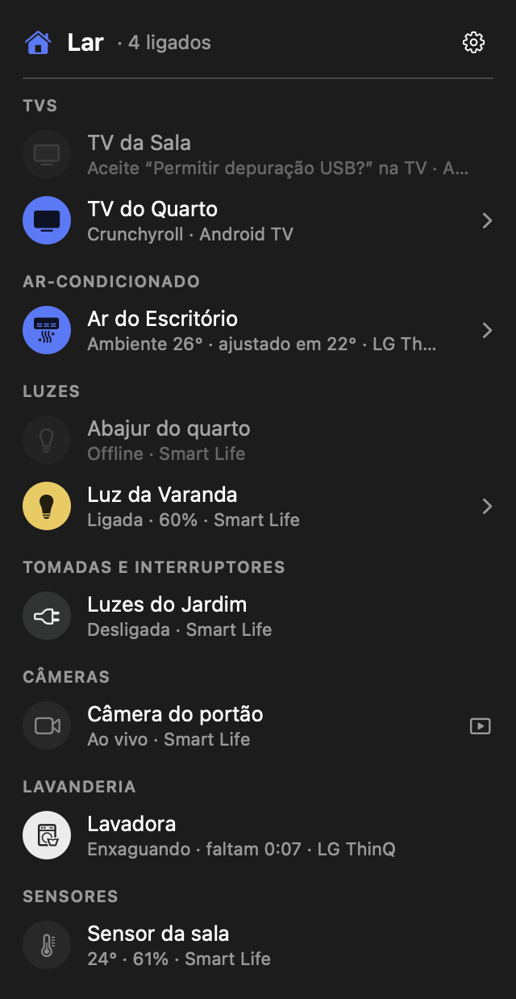
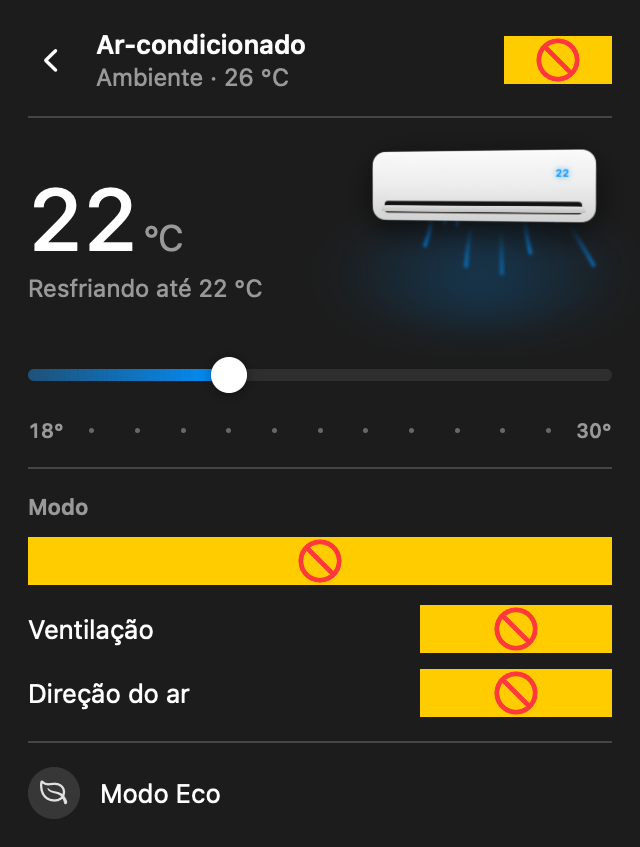
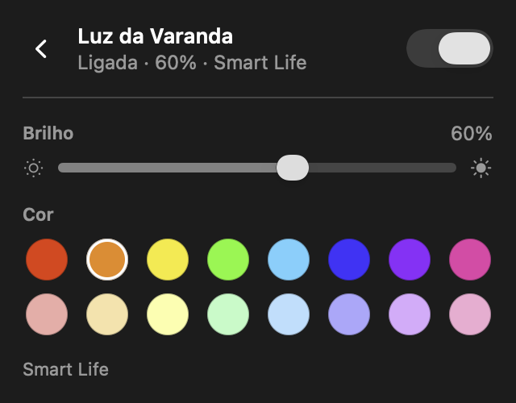
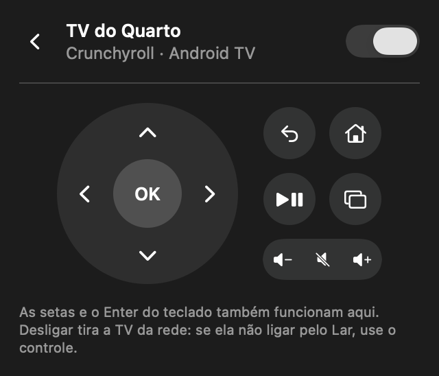

# Lar

**Português** · [English](README.en.md)

**A casa inteira na barra de menus do Mac.** O Lar junta numa lista só os aparelhos da sua conta **LG ThinQ**, do
**Smart Life (Tuya)**, do **SmartThings**, os **Echos da Alexa**, o **Xbox** e as **TVs com Google TV** da sua rede. Um
clique na casinha mostra tudo: liga e desliga, ajusta o ar-condicionado, o brilho e a cor das lâmpadas, abre as
câmeras ao vivo e vira controle remoto da TV. E o Mac leva esses aparelhos para o **app Casa** da Apple e para a Siri.

  

## Onde funciona

No **Mac**, na barra de menus. É o que fica sempre ligado: cenas no horário e o porteiro sempre registrado. Este
repositório é o app do Mac.

Para iPhone, iPad, Apple Watch, CarPlay, Apple TV e Apple Vision Pro, o Lar está na **App Store** (apps à parte,
que não fazem parte deste repositório). O Mac e o iPhone sincronizam cenas, nomes, favoritos e cômodos.

Para experimentar sem nenhuma conta: **"Experimentar com uma casa de exemplo"** na primeira tela (ou Ajustes →
Casa de exemplo).

## Para que serve

- **Ver tudo num lugar só:** em vez de abrir quatro apps no celular, a lista mostra o estado de cada aparelho e de
  onde ele vem ("Ligada · 60% · Smart Life", "Enxaguando · faltam 0:07 · LG ThinQ", "Offline · SmartThings").
- **Ligar e desligar com um clique** no círculo à esquerda (fica colorido quando está ligado).
- **Ar-condicionado:** o LG com tudo (temperatura, modo, ventilação, direção do ar e modo Eco); os do SmartThings
  e do Smart Life com ligar, temperatura do ambiente e a ajustada (− / +).
- **Lâmpadas:** brilho e cor (Smart Life e SmartThings).
- **Câmeras Smart Life:** vídeo ao vivo numa janela, uma ou todas juntas (botão de grade).
- **App Casa e Siri:** o Mac vira uma ponte HomeKit na rede de casa (Ajustes → App Casa). Luzes, tomadas,
  ventiladores, interruptores, ares-condicionados, termômetros e câmeras do Lar aparecem no app Casa do iPhone, do
  iPad e do relógio, e a Siri passa a controlá-los. Um aparelho que já está no app Casa por conta própria pode
  ficar de fora da ponte, para não aparecer duas vezes. O vídeo das câmeras passa pelo Mac, que precisa ficar ligado.
- **TVs com Google TV:** ligar e desligar, ver o que está passando e um controle remoto completo (direcional,
  voltar, início, play/pause, volume, canal, entradas e os apps da TV), e digitar na busca aberta da TV. As setas e
  o Enter do teclado do Mac também funcionam.
- **TV Samsung e soundbar (SmartThings):** controle remoto com direcional, voltar, início, volume, mudo, canal,
  entradas e apps (a soundbar: volume, mudo e entrada).
- **Cenas:** um clique liga e desliga vários aparelhos de uma vez ("Dormir", "Cinema"), e pode definir a temperatura
  do ar. Crie no "+" de Cenas, escolhendo para cada aparelho Ligar, Desligar ou não mexer (ou "Usar o estado
  atual"). Botão direito para editar.
- **Links:** `lar://cena/Dormir`, `lar://ligar/TV da Sala`, `lar://desligar/…`, `lar://alternar/…` e
  `lar://temperatura/Ar do quarto/23` (no app Atalhos, com "Abrir URL").
- **Organizar a lista:** favoritos no topo, nome próprio no Lar, cômodos (agrupe por tipo ou por cômodo em
  Ajustes → Lista) e aparelhos ocultos, pelo botão direito.
- **Avisos:** notificação quando a lavadora ou a secadora LG termina o ciclo. Dá para desligar em Ajustes → Lista.
- **Atalhos do Mac:** ⌃⌥L abre o Lar de qualquer app, e a temperatura do ar pode aparecer ao lado da casinha
  (Ajustes → Lista).
- **Ajustes protegidos:** Touch ID ou senha para abrir os Ajustes, onde ficam as chaves.
- **Automações:** cenas no horário (com dias da semana) e "Desligar em…" no menu de cada aparelho.
- **Mac e iPhone iguais:** cenas, nomes, favoritos e cômodos sincronizam pela rede de casa, com criptografia
  (Ajustes → iPhone → Parear um iPhone). As chaves das contas não passam.
- **Histórico do ar:** temperatura das últimas 24 h, tempo ligado hoje e estimativa de kWh e R$ (potência e tarifa
  em Ajustes → Ar-condicionado).
- **Diagnóstico:** em Ajustes, o estado de cada conta, quanto demorou a última leitura e o último erro, com um
  relatório para copiar sem nenhuma chave.
- **Xbox:** entre com a conta Microsoft (Ajustes → Xbox) e o console aparece na lista: ligar (da Suspensão) e
  desligar, o controle (setas, A, B, X, Y, Menu, Exibir e o botão Xbox), volume, digitar, abrir jogos e apps e ver o
  que está passando. Integração não oficial (a mesma nuvem que o app Xbox usa): a Microsoft pode mudá-la.
- **Alexa e Echos:** entre com a conta Amazon (Ajustes → Alexa, pela página da própria Amazon). Os Echos entram na
  lista com volume, não perturbe, música, falar, anunciar em todos, "pedir à Alexa" (vale para tudo o que a Alexa
  controla) e as rotinas. O Mac anuncia o porteiro e os avisos (a lavadora pronta) nos Echos. As rotinas da Alexa
  viram cenas do Lar: os passos com aparelhos que o Lar também tem viram comandos; os outros (falar, música, clima)
  a Alexa faz num Echo quando a cena roda. Rotinas novas são importadas a cada hora. Integração não oficial (como a
  do Home Assistant): a Amazon pode mudá-la.
- **Porteiro (VoIP/SIP):** atenda o porteiro, fale e abra o portão (as teclas que ele espera, ex.: `*1`), ou ligue
  para ele. Em Ajustes → Porteiro: servidor, usuário e senha do ramal, número do porteiro e as teclas do portão.
  O Mac fica registrado e toca sempre. Áudio G.711, como todo PABX e porteiro aceita.
- **Sempre aberto:** o Lar inicia com o Mac e volta sozinho se parar sem você mandar sair (dá para desligar em
  Ajustes → Geral).
- **Atualização automática:** o app é assinado e notarizado pela Apple e se atualiza sozinho a partir das releases
  deste repositório (Ajustes → Atualizar sozinho).
- **Sem servidor no meio:** o Lar conversa direto com a nuvem de cada marca e, no caso das TVs, direto com a TV pela
  rede de casa.

| Ar-condicionado | Lâmpada | TV |
|---|---|---|
|  |  |  |

## O Lar e os outros apps de casa

O Lar não substitui o app de cada marca nem uma central de automação: ele **junta numa lista só** o que já está
nas suas contas e leva isso para todos os aparelhos Apple. Não precisa de servidor, de hub nem de conta do Lar.

| | Lar | Home Assistant | Casa (Apple) | Google Home | Apps das marcas (LG ThinQ, SmartThings, Smart Life) |
|---|---|---|---|---|---|
| **O que é** | Um app que junta as suas contas numa lista | Uma central de automação que você hospeda | O app de casa da Apple (HomeKit e Matter) | O app de casa do Google (Nest, Google Assistente, Matter) | O app oficial de cada fabricante |
| **O que precisa** | Só o app e as suas contas | Um computador sempre ligado (Raspberry Pi, servidor ou máquina virtual) e configuração | Aparelhos compatíveis e, para automações, uma central (Apple TV ou HomePod) | Conta Google e aparelhos compatíveis | A conta da marca |
| **Aparelhos** | LG ThinQ, Smart Life/Tuya, SmartThings, Alexa (Echos), Xbox, TVs com Google TV e o app Casa | Milhares de integrações | Só os compatíveis com HomeKit ou Matter | Os do Google, os Matter e as marcas vinculadas | Só os da própria marca |
| **No Mac** | Na barra de menus, sempre aberto | App oficial ou navegador | App Casa | Não tem app | Em geral, não tem app |
| **Apple Watch, CarPlay, Apple TV e Vision Pro** | Todos | Apple Watch e CarPlay, pelo app oficial | Todos | Não tem app para eles | Varia de marca para marca |
| **Recursos de cada aparelho** | O principal: ar-condicionado LG completo, controle remoto das TVs, câmeras, lavadora | Depende da integração | O que o HomeKit expõe | O que o Google expõe | Tudo o que a marca oferece |
| **Porteiro do prédio (SIP)** | Sim | Com integrações extras | Não | Não | Não |
| **Onde ficam os dados** | Nos seus aparelhos (chaves no Porta-chaves) | No seu servidor | No iCloud | Na conta Google | Na conta da marca |

**O Lar conversa com os outros:** no Mac, ele vira uma ponte do **app Casa** (Ajustes → App Casa) e leva os
aparelhos da LG, do Smart Life e do SmartThings para o Casa e para a Siri. As rotinas da **Alexa** viram cenas do
Lar.

**Quando usar outro app:**
- **Para parear um aparelho novo**, atualizar firmware ou usar um recurso muito específico, use o app da marca: o
  Lar só enxerga o que já está na conta.
- **Para automações complexas** (sensores, condições, centenas de integrações, tudo na rede local), use o Home
  Assistant. O Lar faz cenas no horário e "desligar em…", não regras do tipo "se isso, então aquilo".
- **Para comandos de voz**, use a Siri (pelo app Casa, com a ponte do Lar), a Alexa ou o Google Assistente.

**Limites do Lar:** ele depende da nuvem de cada marca (só as TVs são controladas direto pela rede de casa), e
algumas integrações não são oficiais (Alexa e Xbox): a empresa pode mudá-las sem aviso.

## Requisitos

- Mac com **chip Apple (M1 ou mais novo)** e **macOS 15 Sequoia ou mais novo**.
- Em português ou em inglês, conforme o idioma do sistema.
- Pelo menos uma das contas abaixo. Você configura só as que usa.

## Instalar

1. Baixe o `Lar-<versão>.dmg` na página de [Releases](../../releases/latest).
2. Abra o DMG e arraste o **Lar** para a pasta **Aplicativos**.
3. Abra o Lar. Ele é assinado e notarizado pela Apple, então abre direto, sem aviso do macOS.
4. A casinha aparece na barra de menus. Sem nenhuma conta configurada, o Lar abre direto nos **Ajustes**.
5. Se o macOS perguntar se o Lar pode **encontrar dispositivos na rede local**, clique em **Permitir**: é assim que
   ele acha e controla as TVs.

O Lar já abre junto com o Mac. Para mudar: Ajustes do Lar → **Abrir ao iniciar o Mac**.

## Configurar cada conta

Tudo fica em **Ajustes** (a engrenagem no canto). Cada chave é guardada no **Porta-chaves do Mac**, só neste Mac, e
nunca aparece de volta na tela. Ao lado do nome de cada conta, os Ajustes mostram se ela conectou e quantos aparelhos
encontrou.

### LG ThinQ (ar-condicionado, lavadora, geladeira…)

1. Acesse [connect-pat.lgthinq.com](https://connect-pat.lgthinq.com) e entre com a sua conta LG (a mesma do app
   LG ThinQ).
2. Crie um **Personal Access Token** e copie. Ele começa com `thinqpat_`.
3. No Lar: Ajustes → **LG ThinQ** → cole o token → **Salvar**.

O Lar usa a região das Américas (contas do Brasil). Os aparelhos precisam já funcionar no app LG ThinQ.

### Smart Life / Tuya (lâmpadas, tomadas, câmeras, sensores)

Vale para o app **Smart Life** e para marcas que usam a plataforma Tuya (Nova Digital, Ekaza e muitas outras).

1. **Junte tudo no app Smart Life.** O Lar só enxerga contas do Smart Life (ou do Tuya Smart). Se um aparelho estiver
   no app da própria marca, remova-o de lá, resete o aparelho e pareie de novo no Smart Life, no Wi-Fi de 2,4 GHz.
2. **Crie um projeto na Tuya** (grátis, uns 10 minutos):
   1. Crie uma conta em [iot.tuya.com](https://iot.tuya.com).
   2. **Cloud → Development → Create Cloud Project**. Development Method: **Smart Home**. Data Center: **Western
      America** para contas do Brasil e das Américas.
   3. Em **Service API**, autorize **IoT Core** e, para as câmeras, **IoT Video Live Stream**.
   4. Na aba **Devices → Link App Account**, aparece um QR code. No app Smart Life: **Eu → ícone de escanear** e leia
      o código. Os aparelhos aparecem na lista do site.
   5. Na página do projeto, copie o **Access ID** e o **Access Secret**.
3. No Lar: Ajustes → **Smart Life (Tuya)** → cole o Access ID e o Access Secret, escolha a região (**Américas**) →
   **Salvar**.

> O app de uma marca específica (Nova Digital, Ekaza…) mostra "Please use the designated app" ao ler o QR code: é
> esperado. Só o Smart Life e o Tuya Smart podem ser vinculados ao projeto.

> O serviço IoT Core vem como teste gratuito com prazo. Quando estiver perto de vencer, o próprio site da Tuya oferece
> renovar de graça para uso pessoal. Se o Lar mostrar "Smart Life: a chave foi recusada", é isso.

### SmartThings (TVs e soundbars Samsung, e o que estiver no SmartThings)

Há três jeitos.

**Configurar automaticamente (o mais simples).** Em Ajustes → **SmartThings** → **Configurar automaticamente**, o
Lar abre o login da Samsung numa janela. Entre na conta e toque em **Authorize**: o Lar cria um token temporário
(vale 24 horas e não fica guardado), cria a integração deste Mac e preenche tudo sozinho. Em **Como criar à mão**
há o passo a passo para fazer sem o Lar, com os comandos prontos para copiar.

**Token pessoal (para testar).** Crie em [account.smartthings.com/tokens](https://account.smartthings.com/tokens) e
cole em Ajustes → **SmartThings** → **Salvar**. Os tokens novos **valem só 24 horas**.

**OAuth com um token pessoal, uma integração por aparelho.** O Lar renova o acesso sozinho, e cria a integração
para você:

1. Crie um token pessoal em [account.smartthings.com/tokens](https://account.smartthings.com/tokens) com a
   permissão de **apps** (além de dispositivos e locais). Ele só serve para criar a integração e não fica guardado.
2. No Lar: Ajustes → **SmartThings** → ligue **Usar OAuth** → cole o token → **Criar a integração deste aparelho e
   entrar** (no Mac, **Criar e entrar**).
3. Entre na sua conta Samsung na página que abrir (marque "manter conectado", se aparecer). Pronto: o Lar cria a
   integração "Lar (iPhone)", "Lar (Mac)"…, pega o código e o refresh token sozinho.

Repita em cada aparelho: **cada um precisa da sua integração**. O refresh token muda a cada renovação, e dois
aparelhos com a mesma se desconectam um ao outro. O Lar impede isso: o Mac e o iPhone pareados contam um ao outro
qual integração usam (só uma impressão do Client ID, nunca o ID ou o secret), avisam quando é a mesma e recusam
entrar com a do outro. O relógio também ganha a sua, em Ajustes → **SmartThings no relógio**.

Se a Samsung recusar o token depois (outro aparelho renovou, por exemplo), o Lar entra de novo sozinho, sem você
fazer nada, enquanto a sessão da conta Samsung valer; senão, avisa para entrar de novo.

Ainda dá para usar uma integração criada à mão (`smartthings apps:create`, tipo **OAuth-In App**, escopos
`r:devices:*`, `x:devices:*` e `r:locations:*`, redirect `https://httpbin.org/get`): cole o Client ID e o Client
Secret e toque em **Entrar no SmartThings**.

O Lar precisa ficar aberto pelo menos uma vez a cada ~30 dias para o acesso não expirar. **Não use o mesmo refresh
token em outro programa:** ele muda a cada renovação, e um invalidaria o outro. Para outro programa, crie outra
integração.

"Offline" no Lar é o que o próprio SmartThings informa (aparelho sem conexão). Um aparelho conectado e desligado
aparece como "Desligado" e pode ser ligado pelo Lar.

### TVs com Google TV

As TVs são **encontradas sozinhas** na rede de casa, mesmo quando o roteador muda o IP delas. Há dois jeitos de o
Lar controlar uma TV.

**Pareando com o código (o mais simples).** É o mesmo controle do app Google TV; não precisa mexer nas
configurações da TV. Com a TV ligada, abra-a na lista do Lar e clique em **Parear com a TV** (no Mac, quando a TV
também aceita o ADB, o botão se chama **Parear sem depuração**). A TV mostra um código de 6 letras e números: digite
no Lar e confirme. É uma vez por TV e por aparelho (Mac e iPhone pareiam cada um o seu). Pareada, a TV liga e
desliga, recebe as teclas do controle e abre os apps mais comuns (Netflix, YouTube, Prime Video…).

**Pela depuração USB (só no Mac).** Além do controle, lista todos os apps instalados na TV:

1. Na TV: Configurações → **Sistema → Sobre** (ou Preferências do dispositivo → Sobre) → clique **7 vezes em
   "Build"** até aparecer "Você é um desenvolvedor".
2. Volte e abra **Opções do desenvolvedor** → ligue **Depuração USB**. (Em algumas TVs há também "Depuração pela
   rede" ou "ADB pela rede": ligue também.)
3. Abra o Lar. Na primeira conexão, a TV mostra **"Permitir depuração USB?"**: marque **"Sempre permitir"** e
   confirme com o controle. Só é preciso uma vez por TV.

Nos Ajustes (**Google TV**) dá para desligar a busca automática, digitar o IP de uma TV que não aparece sozinha e
esquecer as TVs que não estão na rede.

**Sobre ligar a TV pelo Lar:** desligar sempre funciona. Para ligar, a TV precisa continuar na rede em repouso.
Muitas TVs desligam o Wi-Fi em repouso; nelas o Lar tenta o Wake-on-LAN (que costuma funcionar com cabo de rede) e,
se não der, avisa para usar o controle.

**Segurança:** a depuração USB dá controle total da TV a quem a TV autorizar. Só aceite o pedido quando for o seu
Mac, e desligue a depuração se não for mais usar o Lar na TV.

### Xbox

1. No Lar: Ajustes → **Xbox** → **Entrar no Xbox**. Aparece um código.
2. Em qualquer celular ou computador, abra [microsoft.com/link](https://www.microsoft.com/link), digite o código e
   entre com a conta Microsoft do Xbox (a de um adulto). A senha fica na página da Microsoft, não passa pelo Lar.
3. No Xbox, uma vez só:
   - Configurações → **Dispositivos e conexões → Recursos remotos**: marque **Habilitar recursos remotos**.
   - Na mesma tela, em **Preferências do app Xbox**: **Permitir conexões de qualquer dispositivo**.
   - Configurações → **Geral → Opções de energia**: escolha **Suspensão**. Em **Economia de energia** o Xbox não
     liga pelo Lar.

Se o Xbox não responder, reinicie o console: segure o botão Xbox por 10 segundos e ligue de novo. O mesmo passo a
passo está em Ajustes → Xbox → **Como preparar o Xbox**.

## Privacidade e segurança

- **Sem servidor do Lar, sem conta do Lar, sem coleta de dados.** O app só fala com a LG, a Tuya, a Samsung, a
  Amazon e a Microsoft (com as suas chaves), com as TVs da sua rede e com o app Casa dos seus aparelhos Apple.
- **Ponte do app Casa:** só na rede de casa, com o pareamento e a criptografia do HomeKit. Em Ajustes → App Casa →
  **Remover da Casa**, o Lar esquece todos os pareamentos.
- **Chaves das contas:** no Porta-chaves do Mac, só neste Mac (sem sincronizar com o iCloud).
- **Sincronização Mac ↔ iPhone:** só na rede de casa, cifrada com uma chave que só os aparelhos pareados têm. O
  pareamento usa troca de chaves ECDHE (quem gravar a rede não descobre o código depois), o código vale 2 minutos e
  para depois de 5 tentativas erradas.
- **Chave das TVs:** em `~/Library/Application Support/Lar/adbkey`, legível só pelo seu usuário, como o `adb`
  faz.
- **Remover tudo:** em Ajustes, **Remover** em cada conta; para apagar a chave das TVs, apague a pasta
  `~/Library/Application Support/Lar`.

Política completa: [privacidade.md](docs/privacidade.md).

## Problemas comuns

| O que aparece | O que fazer |
|---|---|
| "A chave foi recusada" | O token expirou ou foi revogado. Crie outro e cole em Ajustes. |
| Aparelho "Offline" | A própria nuvem da marca diz que ele está sem conexão. Confira no app da marca, a energia e o Wi-Fi. |
| TV: "Aceite 'Permitir depuração USB?' na TV" | Aceite na TV, marcando "Sempre permitir". |
| TV: "A TV não respondeu" | Confira se a TV está ligada, na mesma rede e com a depuração USB ligada. |
| O macOS pede para o Lar usar o Porta-chaves | Clique em "Sempre permitir" (acontece depois de atualizar o app). |
| Xbox: "O Xbox não respondeu" | Confira a Suspensão e os recursos remotos no Xbox (veja Configurar → Xbox) e reinicie o console. |
| Câmera não abre | O projeto da Tuya precisa do serviço **IoT Video Live Stream** autorizado. |

## Contribuir

O Lar é gratuito e de código aberto, feito pela [Coupled](https://www.coupled.com.br). No app, o botão **ⓘ** (Sobre
o Lar) reúne tudo isto.

- **Problemas e ideias:** abra uma [issue](https://github.com/coupledtec/Lar/issues/new) com o que aconteceu, o
  aparelho, a versão e o relatório do Diagnóstico (sem chaves).
- **Código:** fork, branch e pull request; veja o [guia de contribuição](CONTRIBUTING.md).
- **Para o Lar continuar gratuito** (a anuidade de desenvolvedor da Apple é de US$ 99 por ano):
  [GitHub Sponsors](https://github.com/sponsors/coupledtec), [Buy Me a Coffee](https://buymeacoffee.com/coupled) ou
  **PIX** para o CNPJ da Coupled, `41.107.909/0001-20`. Nos apps da App Store, a gorjeta fica em Ajustes → Sobre o Lar.

## Compilar a partir do código

Veja [DEVELOPMENT.md](DEVELOPMENT.md). Resumo: `scripts/test.sh` (testes), `scripts/build-app.sh --install` (instala
em Aplicativos) e `scripts/make-dmg.sh` (gera o DMG da release). Bastam as Command Line Tools do Xcode.

## Créditos e licença

A integração com o Xbox segue o protocolo documentado pelo [xbox-webapi-python](https://github.com/OpenXbox/xbox-webapi-python)
(OpenXbox, MIT), o mesmo que o Home Assistant usa.
A integração com a Alexa segue o que fazem o [aioamazondevices](https://github.com/chemelli74/aioamazondevices)
(Simone Chemelli e colaboradores, Apache-2.0) e o [alexa-remote](https://github.com/Apollon77/alexa-remote) (Apollon77, MIT).
O controle do ar-condicionado LG vem do [Celsius](https://github.com/gbvillarinho/celsius), de Gabriel Villarinho
(licença MIT). O Lar acrescenta as outras contas, as TVs e o restante.

Licença [MIT](LICENSE). O Lar não é afiliado à LG, à Tuya, à Samsung, à Amazon, à Microsoft nem ao Google; os nomes são marcas dos seus
donos.
